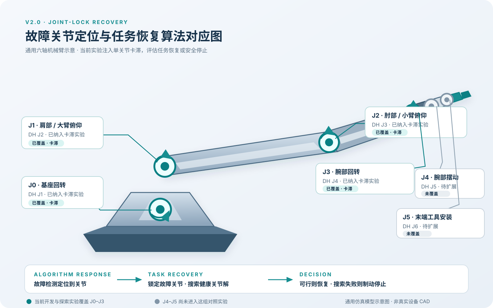

# 成员 B · 单关节卡滞任务恢复实验

2026-11-25，成员 B 开发集、探索集与预先冻结验证集记录。分支为 `feature/member-b-task-recovery`。验证目标和注入时刻在本轮验证运行前已固定，但制定时已查看开发集和探索集结果，因此不是独立盲测。

## 在仓库根目录复现

Python 3.11 可以直接运行本实验。每次执行生成一份 summary.json，每个 run_id 对应一份 800 帧的压缩 CSV。V2 的恢复指令使用 1.0 rad/s 速度上限、2.0 rad/s² 加速度上限，控制周期与 100 Hz 仿真一致。边缘节点从 `fault_tolerance` YAML 配置读取这两个上限。

~~~powershell
python edge/edge_node/test/benchmarks/run_task_recovery.py --output-dir edge/edge_node/test/reports/task_recovery/my-run
~~~

加 `--scenario "LOCK-J1#s1T1"` 可只跑开发集肩关节案例。验证集复现命令如下：

~~~powershell
python edge/edge_node/test/benchmarks/run_task_recovery.py --split validation --output-dir edge/edge_node/test/reports/task_recovery/member-b-validation-frozen-r1 --json edge/edge_node/test/reports/task_recovery/member-b-validation-frozen-r1/summary.json
~~~

旧版 pilot 轨迹位于 `edge/edge_node/test/reports/task_recovery/member-b-validation-r2/`，限速开发集复跑位于 `edge/edge_node/test/reports/task_recovery/member-b-locktorque-r1/`，限速探索集复跑位于 `edge/edge_node/test/reports/task_recovery/member-b-locktorque-exp-r1/`，验证集轨迹位于 `edge/edge_node/test/reports/task_recovery/member-b-validation-frozen-r1/`。大型轨迹目录已加入 Git 忽略规则。[pilot 逐次结果](member-b-pilot.json)；[限速开发集结果与代码校验值](member-b-limited-r3.json)；[限速探索集结果](member-b-limited-exploratory.json)；[冻结验证集逐次结果与代码校验值](member-b-validation-frozen-r1.json)；[失败模式分析](member-b-failure-analysis.md)。

新增探索性实验划分：

~~~powershell
python edge/edge_node/test/benchmarks/run_task_recovery.py --split exploratory --output-dir edge/edge_node/test/reports/task_recovery/member-b-exploratory --json edge/edge_node/test/reports/task_recovery/member-b-exploratory/summary.json
~~~

`development` 使用早期目标，`exploratory` 使用另外两组目标，`validation` 使用第三组目标和 0.40、0.80、1.20 秒三个注入时刻。validation 目标与前两组不重合，场景种子标记为 300、301、302。当前被控对象是确定性的，未使用随机数。验证目标在该验证集运行前已固定，不过制定时已能查看开发和探索结果，因此只作为预先冻结的留出集结果报告，不称独立盲测或确认性验证。summary 记录算法、场景、被控对象和配置的 SHA-256。

## 方法和判据

4 个故障关节 × 3 个注入时刻 × 2 个点到点任务，共 24 个场景。开发集在 0.30、0.45、0.60 秒注入，冻结验证集在 0.40、0.80、1.20 秒注入。每个场景用同一六轴 Python plant 和位置伺服，容错关闭、V1、V2 三种策略各运行一次。每次仿真 8 秒，步长 0.01 秒。关节编号从 0 起。

检测器确认卡滞后，V2 固定故障关节，以原任务终点的三维位置为目标，对健康关节做带限位的阻尼最小二乘搜索。先从当前关节位置搜索，必要时从满足锁定约束的原任务关节目标再试一次。规划位置误差容差为 0.02 m。搜索失败时记录 NO_FEASIBLE_PLAN，根据关节速度估算制动目标并锁存停止决策。目标的几何可达性需独立标注。

| 当前仿真评分判据 | 计算方法 |
|---|---|
| 恢复 | 卡滞期间实测末端距目标 ≤ 0.05 m，连续至少 0.25 s 并保持至结束。停止决策另计。 |
| 停稳 | 从 STOP 下发开始 2 s 内，所有关节实测速度均 ≤ 0.05 rad/s 并保持至少 0.25 s，之后至结束均维持。stop_time_s 计至持续满足速度阈值的首帧。 |
| 全程边界 | 全部关节角绝对值 ≤ π rad、速度 < 1.96 rad/s，峰值力矩不得超过 50 N·m，故障关节故障期间平均绝对力矩 < 15 N·m。速度裕度和力矩阈值沿用 V1 历史评分。 |
| 确认延迟 | 注入至检测器首次报告同一关节 JOINT_LOCKED，按仿真时间计算。 |

## 结果

V2 根据规划出的关节恢复目标生成速度、加速度受限指令。开发集算法修订复跑结果如下。

| 限速版开发集策略 | 稳定到达原目标 / 24 | 发出 STOP 并实测停稳 / 24 |
|---|---:|---:|
| 容错关闭 | 3 | 0 |
| V1 | 15 | 0 |
| V2 | 18 | 6 |

卡滞期间，仿真将故障关节的测量反作用力矩设为 12.5 N·m，不向被控对象额外施力。该值高于检测阈值 10 N·m，且低于故障关节平均力矩评分上限 15 N·m。按故障关节分组，V2 的 J0 为 0/6 恢复、6/6 停稳，J1、J2、J3 各 6/6 恢复。恢复评分通过的 V2 运行峰值关节速度不超过 0.99 rad/s、峰值力矩为 12.5 N·m。逐次结果和源码 SHA-256 见 `member-b-limited-r3.json`。

对已使用过的探索目标运行限速版诊断复跑，结果不属于独立盲测。

| 限速版探索集策略 | 达到轨迹恢复评分 / 24 | 发出 STOP 并实测停稳 / 24 |
|---|---:|---:|
| 容错关闭 | 6 | 0 |
| V1 | 18 | 0 |
| V2 | 19 | 5 |

逐次结果和源码 SHA-256 见 `member-b-limited-exploratory.json`。限速版 V2 的 24 个探索样本均记录到故障确认；J2 六个样本均记录到确认和恢复动作。J3 有 1 个样本没有故障确认或恢复动作记录但达到轨迹位置评分，不能归因于算法决策。

validation 场景在本轮运行前冻结，三策略配对结果如下。由于目标是在先前实验结果可见后制定，该结果不代表独立盲测。

| 预先冻结验证集策略 | 达到轨迹恢复评分 / 24 | 发出 STOP 并实测停稳 / 24 |
|---|---:|---:|
| 容错关闭 | 11 | 0 |
| V1 | 19 | 0 |
| 限速 V2 | 21 | 3 |

逐次结果与源码 SHA-256 见 `member-b-validation-frozen-r1.json`。V2 的 24 个场景均记录故障确认及动作，其中 21 个作出 RECOVER 并达到恢复评分，3 个作出 STOP 并通过停稳评分。按关节分组，J0 为 3/6 恢复、3/6 停稳，J1、J2、J3 各 6/6 恢复。

限速且加入卡滞反作用测量后的上一轮清单保留在同名 `member-b-limited-*.json` 的历史文件版本中，未限速 pilot 逐次数字保留在 [member-b-pilot.json](member-b-pilot.json)，早期探索数据保留在 [member-b-exploratory.json](member-b-exploratory.json)。逐次 CSV 位于 summary 中 `raw_directory` 指定的本地目录，按 `run_id` 关联。探索集目标在查看开发结果后构造，不能作为独立盲测或确认性验证。规划器搜索失败的 `NO_FEASIBLE_PLAN` 不等价于数学证明目标不可达。实验评价末端位置，不覆盖姿态与抓取。

## A、C 联调

- A 可回放 `LOCK-J1#s1T1` 的肩关节恢复。0.30 s 注入，0.54 s 作出恢复决策，末帧误差 0.011438 m。该运行达到健康关节速度上限，按本说明冻结的裕度判据不能计作成功。基座停止用 `LOCK-J0#s1T1`，0.66 s 下发停止目标，0.11 s 后进入停稳速度范围。
- C 可按 run_id 关联汇总与 CSV。command_t_s 对应采样与下发时刻，t_s 对应积分后的实测时刻。ref0…5 是轨迹参考，cmd0…5 是实际指令，q、qd、tau 是位置、速度和力矩。action 记录决策，recovered 和 safe_stopped 记录评分结果。
- 边缘配置通过 TASK_RECOVERY_ENABLED=true 启用，离线脚本按策略选择控制器。显式 STOP 在 ROS 2 路径发布当前位置目标，在 MQTT 路径发布 STOP 消息并让仿真端退出安全伺服。2026-11-25 已将 `test_status_e2e.py` 改为 pytest 集成测试。真实 MQTT broker 转发指令和仿真原始状态，生产 `MqttClient` 与 `StateProcessor` 完成处理，独立 MQTT 客户端断言 STOPPED、ERROR、RUNNING 三种接收状态以及时间戳、关节数据和设备标识。每轮使用独立的 `test/status-e2e/<uuid>/...` 主题，等待订阅确认后发消息。云端应用消费者和 Docker、ROS 2 联合演示仍待验证。

## 合成卡滞力矩读数敏感性实验

2026-11-25，沿用 validation 的 24 个基础场景，将合成卡滞力矩读数分别设为 11、12.5、14 N·m，三种策略各跑一次，共 72 个场景变体、216 次运行。每档读数均高于 10 N·m 卡滞检测阈值，低于 15 N·m 故障关节平均读数评分上限。该参数表示人为指定的传感器读数，不由约束动力学计算，也不向被控对象额外施力。

| 合成卡滞力矩读数 / N·m | 容错关闭恢复 | V1 恢复 | V2 恢复 | V2 安全停稳 |
|---|---:|---:|---:|---:|
| 11 | 11/24 | 19/24 | 21/24 | 3/24 |
| 12.5 | 11/24 | 19/24 | 21/24 | 3/24 |
| 14 | 11/24 | 19/24 | 21/24 | 3/24 |

三档中，V1 和 V2 均确认了各自全部 24 个故障，确认延迟均为 240 ms。V2 恢复时间为 0.26–2.86 s，定义包含故障后至少 0.25 s 的最终持续达标时间。STOP 下发后 0.04–0.22 s 进入停稳速度范围，再满足至少 0.25 s 的保持判据。V2 全程峰值关节速度为 0.999968 rad/s，峰值力矩读数分别为 11、12.5、14 N·m。

这三档无噪声读数均触发同一检测分支，恢复与停稳计数相同。实验覆盖阈值之间的三档读数，尚未覆盖检测阈值附近、读数噪声、约束反力动力学和额外负载变化，仍沿用先前结果可见后制定的验证目标。三档共享基础场景，不能作为 72 个独立目标或随机重复实验解释。逐次结果、分档汇总及七个源码/配置文件的 SHA-256 已保存，可按 run_id 找到原始轨迹。[敏感性实验数据](member-b-locktorque-sensitivity-r1.json)

在仓库根目录运行以下命令可以复现。

~~~powershell
py edge/edge_node/test/benchmarks/run_task_recovery.py --split validation --lock-reaction-torques 11 12.5 14 --output-dir edge/edge_node/test/reports/task_recovery/member-b-locktorque-sensitivity-r1 --json docs/member-b-locktorque-sensitivity-r1.json
py -m pytest -q edge/edge_node/test
~~~

本机 `py` 使用安装了项目依赖的 Python 3.11。PATH 中的独立 `pytest.exe` 指向旧 Python 3.8，因此使用 `py -m pytest`。broker 默认 `localhost:1883`，可通过 `MQTT_TEST_BROKER` 和 `MQTT_TEST_PORT` 设置测试地址。broker 拒绝连接时集成测试跳过，订阅或消息接收超时会使测试失败。

本轮全量边缘测试为 122 项通过，包含真实 broker 集成测试。另以未监听端口验证了合理跳过，并在单独测试进程中临时禁用状态发布，确认独立订阅端因收不到消息而使测试失败。该负向检查不修改磁盘源码。当前 paho-mqtt 2.1.0 对 Callback API v1 产生 7 条弃用警告。216 份原始轨迹共 172800 帧已检查完整性、有限数值、故障关节锁定和合成力矩读数，七个清单校验值与当前源码一致。大型轨迹位于清单的 `meta.raw_directory` 所指本地目录，并已由 Git 忽略规则排除。

## 力矩传感器噪声敏感性探索

2026-11-25 完成探索集噪声试验，覆盖 J0–J3、9/11/13 N·m 合成卡滞读数、三档高斯读数噪声和两个随机种子，共 864 次仿真。V1、V2 共用检测器，整体均为 109/144 故障检出，漏检 35 次。11 与 13 N·m 条件三档噪声下均为 16/16 检出，平均确认延迟 240 ms。9 N·m 低于检测阈值，σ=0、1.5、3 N·m 时分别为 0/16、1/16、12/16 检出，检出会延迟至数秒。V1、V2 在 144 次无故障对照中均未观察到误报。读数和噪声为合成输入，实验不代表传感器标定或实体机械臂验证。方法、分档结果、复现命令和适用范围见 [传感器噪声敏感性实验记录](member-b-sensor-noise-exploratory-r1.md) 与 [逐次结果数据](member-b-sensor-noise-exploratory-r1.json)。

随后将 `edge_config.yaml` 中在线启用的 `RobotSignalFilter` 加入离线任务恢复基准，滤波状态同时送入检测器和控制器。相同探索矩阵下 V1/V2 检出 112/144，漏检 32 次，无故障误报 0/144；9 N·m、σ=3 N·m 检出 15/16，但平均延迟仍为 1.865 s。由于滤波改变闭环状态与轨迹，该组结果单独记录，不把计数变化归因为检测器改进。复现方法与完整分档结果见 [在线滤波噪声敏感性记录](member-b-sensor-noise-online-filter-r1.md) 和 [逐次结果数据](member-b-sensor-noise-online-filter-r1.json)。

基准脚本现支持 `--lock-torque-threshold` 记录候选检测阈值，默认仍为 10.0 N·m。8.5 N·m 在线滤波复核在 validation 的 24 个故障场景中实现 24/24 故障确认，V2 为 21/24 恢复、3/24 安全停稳。该结果与早期阈值探针一致，但验证集没有无故障对照，8.5 N·m 只作为候选配置，不替换默认值。详见 [8.5 N·m 阈值复核记录](member-b-validation-threshold85-r1.md) 和 [逐次结果数据](member-b-validation-threshold85-r1.json)。

随后在同一 validation 条件下，对 8.5 与 10.0 N·m 两个阈值各加入 24 条匹配无故障轨迹，并启用在线滤波，每档共 144 次仿真。两档均为 V1、V2 故障检出 24/24、匹配对照误报 0/24、平均确认延迟 251.667 ms，恢复与停稳结果逐场景相同。该结果只适用于本轮 12.5 N·m 合成读数与既有场景，不能代表阈值附近或其他正常负载下的误报表现。默认仍为 10.0 N·m。详见 [配对阈值复核报告](member-b-validation-threshold-paired-r1.md)、[8.5 N·m 逐次数据](member-b-validation-threshold-paired-r1-8p5.json) 和 [10.0 N·m 逐次数据](member-b-validation-threshold-paired-r1-10p0.json)。

2026-11-26 完成阈值与传感器噪声敏感性矩阵，比较 8.5、10.0 N·m 两档检测阈值，8/9/10/11 N·m 合成卡滞读数及 0/1.5/3 N·m 高斯读数噪声。每阈值 288 个故障条件及 72 条按噪声匹配的无故障对照，三策略共 1,080 次运行，两阈值合计 2,160 次。8.5 N·m 的 V1/V2 检出 264/288，10.0 N·m 检出 154/288，两者各自 72 条无故障对照均未记录误报。8 N·m 无噪声时两个阈值都未检出。该矩阵使用单一随机种子和曾用于实验的 validation 场景，不能作为独立盲测或通用误报率。默认阈值仍为 10.0 N·m。详见 [阈值与噪声敏感性报告](member-b-validation-threshold-sensitivity-r1.md) 和 [逐次结果数据目录](member-b-validation-threshold-sensitivity-r1/)。

针对“卡滞后任务目标在当前约束下是否可达”，2026-11-26 对 J0 基座回转轴的 `VALIDATION-LOCK-J0#s1T1` 与 `VALIDATION-LOCK-J0#s1T2` 两个目标重新运行关闭容错、V1、V2 三策略，并为每个目标配对无故障对照。T1 从 V2 卡滞轨迹提取到一组 J0 固定在 0.028222729 rad 的关节状态，正运动学末端位置误差 0.016335 m，低于 0.020 m 存在性见证容差；闭环 V2 恢复耗时 2.86 s。T2 的实测 J0 锁定角为 -0.052781084 rad，目标切向投影绝对值为 0.343766 m。两段末端轴向偏距长度和为 0.200 m，因此任何关节配置的末端位置误差至少为 0.143766 m，大于 0.050 m 评分容差。该几何下界独立证明 T2 在 J0 锁定后不可达；V2 输出 `STOP` 并在 0.19 s 达到停稳判据。两个目标下的 off/V1/V2 共六条无故障对照均无误报。复跑汇总、原始轨迹、关节见证和误差下界见 [可达性验证报告](member-b-reachability-validation-r1.md) 与 [机器可读证书](member-b-reachability-certificate-r1.json)，判据脚本为 [validate_reachability.py](../edge/edge_node/test/benchmarks/validate_reachability.py)。本轮目标源自此前已用过的 validation 集，结果是模型内可达性复核，不是独立盲测或实体机械臂验证。
